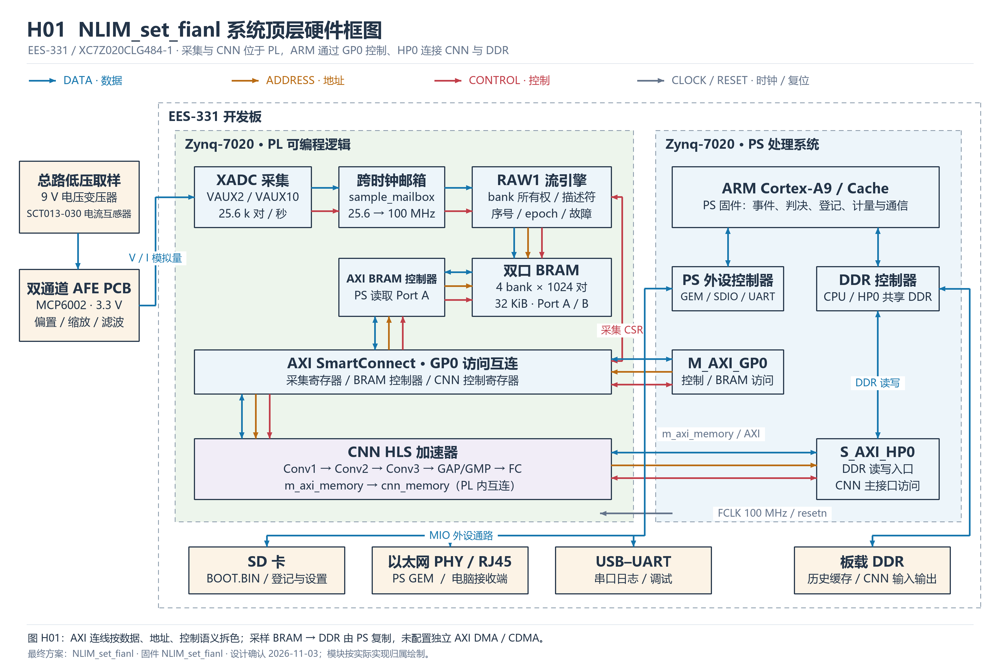

# NLIM_set_fianl

基于 Zynq PS–PL 协同的电器识别与用电监测系统。

仓库采用展开式工程目录，可直接查看源码、仿真、构建脚本、运行文件与报告。平台为 EES331（XC7Z020CLG484-1），配套 V2 PCB 模拟前端；固件标识为 `NLIM_set_fianl`。

## 目录结构

```text
NLIM_set_fianl/
├── README.md                 # 项目简介与复现步骤
├── src/                      # RTL、HLS、PS 固件、硬件 IP 与网页源码
├── sim/                      # 仿真、回归脚本和结果
├── build/                    # 构建脚本、依赖和 reports/ 验证材料
├── board/                    # XSA、bitstream、BOOT.BIN、接收工具与运行说明
├── data/                     # 黄金参考数据与现场日志
├── skill/                    # 可复用 Skill 及校验工具
└── report/                   # 设计报告、软硬件框图与大模型协作记录
```

另有 `checksums.json` 和 `submission_manifest.json`，分别用于完整性校验与交付信息记录。

| 入口 | 内容 |
|---|---|
| [设计报告](report/design_report.md) | 系统架构、PS–PL 分工、识别、登记和计量流程 |
| [硬件与软件框图](report/diagrams/README.md) | 九张 PNG / SVG 框图及 PDF 图集 |
| [源码说明](src/README.md) | PS、HLS、RTL、硬件工程和网页模块 |
| [构建与复现](build/README.md) | 主机回归、硬件重建、PS 编译与启动镜像生成 |
| [板端安装说明](board/release/README.md) | SD 启动、网卡设置、自检与实时演示 |
| [性能报告](build/reports/performance/theoretical_performance.md) | 理论计算、HLS 综合、RTL 仿真与实现材料 |
| [Skill](skill/README.md) | 交付校验、数值比对和诊断流程 |

## 系统架构



PL 负责 XADC 连续采集、跨时钟传递、四缓存组织及 CNN 推理；PS 负责事件提取、KNN 与拒识、登记参考匹配、运行跟踪、计量和规则。网页负责展示、用户操作和日志记录。新电器学习采用持久化参考库增量登记。

## 获取与运行

建议完整克隆仓库，确保启动文件、接收工具和配置成套：

```powershell
git clone https://github.com/PUBAER666/NLIM_set_fianl.git
cd NLIM_set_fianl
```

1. 开发板断电，将 `board/release/sd_card/BOOT.BIN` 复制到 SD 根目录；保留已有 `NILM430.BIN`、`NILM431.BIN` 登记文件。
2. 重新上电，用网线连接电脑。板卡默认 IP 为 `192.168.1.10`，电脑有线网卡设置到同一网段且地址不冲突。
3. 运行 `board/release/check_connection.cmd`，成功后运行 `board/release/start_capture.cmd`。接收工具无需安装 Vitis 或 Python。
4. 日志写入接收工具旁的 `recordings/`。启动文件与接收工具使用本仓库配套版本。

## 本地复现

准备 Python 3.12、MinGW-w64 GCC；硬件重建使用 Vivado/Vitis 2025.2。完整命令见 [build/README.md](build/README.md)。

```powershell
python -m pip install -r build/requirements.txt
powershell -NoProfile -ExecutionPolicy Bypass -File build/test_host.ps1 -Gcc C:/mingw64/bin/gcc.exe -Python python
python skill/ps-pl-release-validation/scripts/test_tools.py
python build/recompute_performance.py
```

核对仓库文件完整性：

```powershell
python skill/ps-pl-release-validation/scripts/verify_delivery.py .
```

## 命名与归档约定

自主整理的目录与图纸文件使用英文，图纸名称采用小写字母和下划线；说明正文使用中文。`README.md`、`SKILL.md`、`CMakeLists.txt`、`BOOT.BIN` 及厂商工具生成的 IP 文件保留工具约定名称。配套 EXE / ELF 保留统一交付名称 `NLIM_set_fianl`。

验证与实现报告归档在 `build/reports/`。历史测试记录保留原版本、日期和来源路径；当前目录与原交付包的对应关系见 [layout_map.json](build/layout_map.json)。厂商 IP 的导出归档作为硬件工程配套文件保留，源码同时展开于 `src/hardware/cnn_ip/`。
