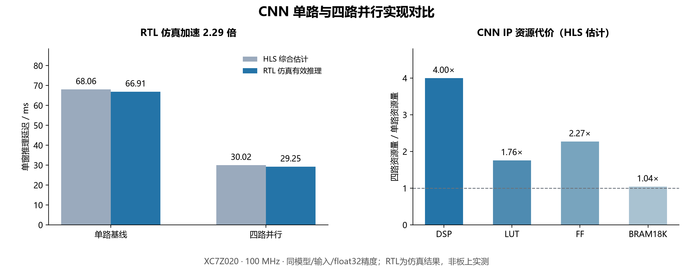

# CNN 并行优化对比报告

实验日期：2026-11-03。比较对象为单输出通道基线与当前四输出通道并行 CNN IP；现有交付固件未改动。

## 结论

在相同器件、100 MHz 时钟、模型权重与 float32 精度下，四路版本的 HLS 最坏延迟估计从 **68.05572 ms** 降至 **30.02349 ms**，加速 **2.267 倍**。同一有效输入的 RTL 仿真延迟从 **66.90917 ms** 降至 **29.24558 ms**，加速 **2.288 倍**、延迟下降 **56.29%**。

24 组主机数值测试中，两版本的 14 个分类分数与 64 个特征逐位一致；与 PS 软件参考的最大绝对误差为 0。单路本次 RTL 检查及四路归档 RTL 检查均通过，所检向量最大绝对误差为 0。这验证了所测输入上的数值一致性，不是分类准确率评估。

## 比较条件

| 条件 | 两版本共同设置 |
|---|---|
| 器件 | XC7Z020CLG484-1 |
| 工具 | Vitis HLS 2025.2；RTL 仿真器 XSIM |
| 时钟约束 | 10 ns，即 100 MHz；时钟不确定度 2.70 ns |
| 网络输入／输出 | 4096 个 float32 电流样本；14 个分数＋64 个特征 |
| 模型 ID | 37ded17f8e17881f |
| 权重 SHA-256 | b8a3c7a4ad71c870e8e77bc35cf1c642dd6ca969c61b1048753ce5ccdb1985bd |
| 数值方式 | float32，禁止浮点乘加收缩；累加 tap 顺序不变 |
| 保留优化 | 8 个位置交错累加、既有 BRAM 缓冲、AXI 接口 |
| 唯一实验变量 | 输出通道并行度 1→4，及与其配套的累加器数量和权重分区 |

单路基线是从当前四路源码构造的匹配基线，并非声称恢复了项目历史上曾上板的旧版本；它也保留流水优化，不是刻意放慢的串行软件实现。改动逐行记录在 `results/source_change.diff`。

## 延迟与资源

| 指标 | 单路基线 | 四路并行 | 加速比 |
|---|---:|---:|---:|
| HLS 最坏延迟 / 周期 | 6,805,572 | 3,002,349 | 2.267× |
| HLS 最坏延迟 / ms | 68.05572 | 30.02349 | 2.267× |
| RTL 有效推理 / 周期 | 6,690,917 | 2,924,558 | 2.288× |
| RTL 有效推理 / ms | 66.90917 | 29.24558 | 2.288× |

| CNN IP 资源（HLS 估计） | 单路基线 | 四路并行 | 四路／单路 |
|---|---:|---:|---:|
| DSP | 5 | 20 | 4.000× |
| LUT | 6,698 | 11,785 | 1.759× |
| FF | 6,191 | 14,067 | 2.272× |
| BRAM18K | 92 | 96 | 1.043× |

资源范围仅为 CNN IP，两列均使用 HLS 估计，未把整个 PL 的实现资源与单个 IP 混用。BRAM 单位为 18 Kb 块。没有进行单路整板布局布线，因此不能据此声称单路整板时序已通过。

| 分层 HLS 最坏延迟 / ms | 单路基线 | 四路并行 | 加速比 |
|---|---:|---:|---:|
| Conv1 | 9.09337 | 6.08263 | 1.495× |
| Conv2 | 24.49457 | 9.93293 | 2.466× |
| Conv3 | 34.32545 | 13.86561 | 2.476× |

## 为什么不是整网 4 倍

四路并行加快了卷积乘加部分，但每通道的后处理、池化／统计、全连接层、AXI 输入输出和控制仍有时间开销。所有这些开销都计入整网延迟；不能把乘加并行度直接写成整网加速倍数。此次结果体现的是资源换延迟：DSP 从 5 个增加到 20 个，整网仿真加速约 2.29 倍。

## 验证过程与证据

1. 2026-11-03 重新编译并测试两版本：零输入、脉冲、常量及不同幅值的基波＋三次谐波＋确定性噪声，共 24 组。每组检查 78 个输出，并直接比较单路与四路浮点位模式。
2. 同一天分别完成单路和四路 HLS 综合。四路新生成的 68 个 Verilog／存储初始化文件与旧 RTL 逐字节相同，且资源、延迟报告一致。详见 `results/four_rtl_reproduction.json`。
3. 单路本次使用测试 case 3 完成 C/RTL 协同仿真；四路使用 2026-10-31 同一 case 的既有通过记录。四路另有 case 0/1/2 的既有通过记录；四组终止仿真时刻相同。四路没有伪称本次重新仿真。
4. 每轮 RTL 测试包含两笔错误 ABI／模型请求和一笔有效推理。前两笔仅耗 3 周期，因此报告中的平均延迟不能代表 CNN 推理延迟。本表取有效推理事务的周期数，排除快速拒绝请求。
5. 保留原始报告和日志，结果脚本从 XML／报告提取数值，未手工填写加速比。

关键文件：`results/host_pair.log`、`results/single_cosim.log`、`evidence/single_fresh_cosim/`、`evidence/four_archived/cosim_case3.log`、`evidence/*_fresh_synth/`、`results/comparison_metrics.json`。

## 报告可用表述

> 为量化硬件并行优化的收益，构建了与当前实现具有相同模型权重、数值精度及接口的单输出通道基线，并与四输出通道并行实现进行对照。在 XC7Z020、100 MHz 条件下，HLS 最坏延迟估计由 68.06 ms 降至 30.02 ms；同一输入的 RTL 仿真有效推理延迟由 66.91 ms 降至 29.25 ms，加速约 2.29 倍。24 组主机测试的分类分数及特征逐位一致，RTL 数值检查通过。代价是 DSP 用量由 5 个增加至 20 个。以上为同条件综合与 RTL 仿真结果。

## 使用边界

本实验未测 PS 运行时间，因此不能写“相对 ARM／CPU 加速 2.29 倍”；也未测整机端到端延迟、功耗或电器识别准确率。160 ms 为名义采样窗口时长；即使两种单窗 CNN 延迟都低于它，也不能单凭此证明多个事件检查点并发、通信与采集共同运行时的实时性。该比较证明了并行硬件对本 CNN 的加速效果，不单独证明使用 FPGA 的必要性。
