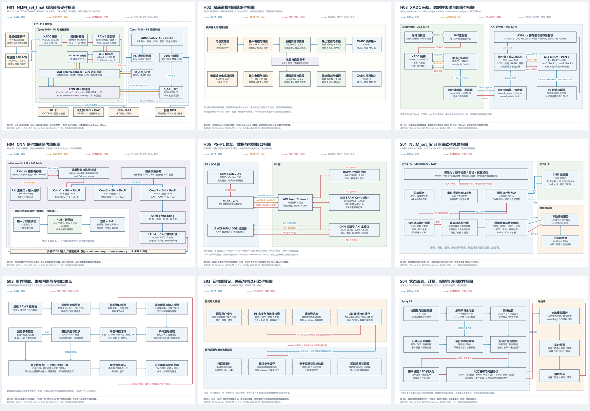

# 设计报告

- [竞赛技术文档](technical_document.docx)
- [验证范围与指标口径](validation_scope.md)
- [CNN 单路与四路对比](../build/reports/cnn_parallel_comparison/comparison_report.md)
- [设计报告](design_report.md)
- [最终方案说明](final_design.md)
- [软硬件框图说明](diagrams/README.md)
- [九页 PDF 图集](diagrams/nlim_set_final_diagrams.pdf)
- [大模型协作记录](ai_collaboration.md)

