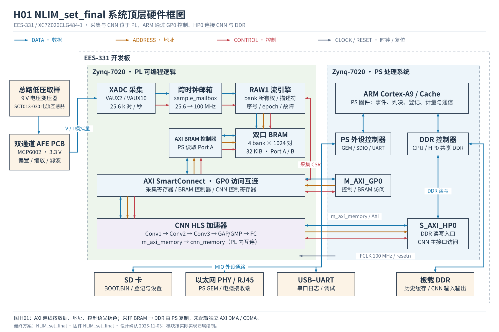

# 基于 Zynq PS PL 协同的电器识别与用电监测系统

## 项目概述

本项目在总回路采集电压和电流，通过开关事件提取与模型判断识别电器状态，并将总功率、电能、碳排估算及规则告警展示在网页中。系统采用 EES331 开发板，器件为 XC7Z020CLG484-1，开发工具为 Vivado/Vitis 2025.2。

项目的工程重点是连续采样、板端计算、未知负载处理与用户确认登记的完整流程。PL 完成采样数据组织和 CNN 特征计算；PS 完成事件管理、识别与拒识、登记匹配、计量和规则判断。网页通过网络读取板端结果并提供操作入口，不承担模型推理或计量计算。

最终设计方案及统一交付名称为 NLIM_set_final，设计确认日期为2026年11月3日。配套固件内部标识为 NLIM_set_final。本文的数值证据与源码对应这一实际版本，报告涵盖系统实现、理论分析、综合与仿真结果及本地功能回归。

## 一 应用价值与设计目标

总回路监测希望在不为每件电器独立安装采集装置的情况下，提供电器运行状态和用电信息。仅输出一个闭集类别无法覆盖用户新增设备；仅依赖上位机计算又使设备持续运行依赖电脑。因此，本系统将计算保留在板端，并把未知提示、人工确认、登记持久保存和错误登记删除作为产品流程的一部分。

系统采用通用功能界面。用户可以设置总功率上限和电器告警名单，将同一套能力用于宿舍管理、实验室或其他用电监测场景。它提供检查提示，不包含自动断电执行机构，也不代替认证的电气保护装置。

本项目采用 KNN、CNN 特征和参考距离等已有算法思想；工程贡献集中于软硬件接口、持续采样与计算协同、可诊断的事件状态机，以及可纠错、可持久化的登记流程。不宣称发明了新的基础神经网络结构。

## 二 系统结构与数据流程

信号链依次经过前端变换与调理、XADC 采样、PL 数据缓存、PS 波形处理、事件识别、状态与计量管理，再经以太网向电脑发送结果。当前换算采用 PCB V2 配置，输出该配置下的功率、电能及碳排估算结果。

| 模块 | 位置 | 输入 | 输出 |
|---|---|---|---|
| 采样与缓存 | PL | 两路模拟输入 | 电压电流 ADC 对、样本编号、块状态 |
| 数据连续性与窗口 | PS | RAW1 数据块 | 4096 点窗口、缺块和异常诊断 |
| 事件提取 | PS | 连续电压电流 | 开机或关机事件、前后波形、残差 |
| CNN 计算 | PL | 4096 点预处理电流 | 14 维 logits、64 维特征 |
| 类别与未知判断 | PS | 五维特征、CNN 输出、参考库 | 已知、未知或待确认 |
| 计量与规则 | PS | 总功率、事件、用户设置 | 电能、碳排估算、超限与名单提示 |
| 展示与登记操作 | 电脑网页 | 板端状态 | 实时页面、用户命令、日志文件 |

采样采用名义 25,600 对/秒。每个数据块为 1024 对，名义时长 40 ms；一个模型窗口为 4096 对，名义时长 160 ms。PL 使用四个采样 bank，PS 保存 64 块 DDR 历史。样本编号、序号和 epoch 用于判断连续性，不能仅因网络连接成功就假定数据有效。

## 三 软硬件划分与接口

卷积包含大量规律性的乘加运算，适合在 PL 中流水执行。状态机、可变参考库、文件持久化和规则判断需要频繁分支与修改，保留在 PS 中。该划分形成独立的 CNN 硬件计算通路，PS 负责事件、判决及业务管理。

CNN 控制接口位于 0x43C10000，采用 AXI 控制和存储访问接口，接口 ABI 为 2，模型标识与参数固定对应。PS 提交输入前处理缓存，结果完成后再读取输出。异步取消并不等于硬件已停止访问内存，因此驱动在复用缓存前处理旧事务，超时后进入故障保护状态。

PS 浮点计算依赖中断现场正确保存。构建脚本检查 IRQHandler 的浮点寄存器保存与恢复，避免中断导致数值结果被破坏。版本自检同时检查固件、模型和 PL 接口，避免旧 BOOT 与新接收工具错配。

RAW 数据服务使用 TCP 9000，状态服务使用 TCP 9001，控制服务使用 TCP 9002。网页桥接程序在电脑本机提供页面，运行时间来自板端，事件以相对时间显示。关闭浏览器不会主动停止板端监测。

## 四 识别与未知负载处理

基础类别集合有 14 类，采用 KNN 与 CNN 相关判断。CNN 的 64 维特征还参与支持范围和未知判断，因此不能把早期训练统计中的 CNN 决策介入比例直接当作当前板端的 CNN 计算占比。

闭集分类只回答现有类别中哪个最像。系统在此之外使用特征支持范围和辅助未知检测逻辑，允许将输入判为未知或暂不确认。这是一种带拒识机制的工程系统，不意味着可以保证识别所有未见类别。

事件处理首先验证采样，再检测功率变化，提取前后波形并进行稳定性检查。新版本在首次变化时冻结此前的稳定背景，后置波形从变化确认后采集。每侧三个窗口的功率标准差要求不超过平均功率的百分之十与 1 W 中的较大值。坏背景报告 BACKGROUND_UNSTABLE；后侧不稳定允许继续等待后续窗口。最终需要连续两个检查点给出一致判断，每个检查点包含三个窗口。

基模型判未知后，系统查询登记库。登记候选必须满足绝对特征支持范围，并与第二近的不同登记名称具有足够区分度；工程配置中的距离比为 1.2。原模型已知结果仍受保护，不被登记名称直接覆盖。该距离比作为登记匹配的工程配置参数。

## 五 新电器登记与持久化

用户观察未知事件并确认实际电器名称后，可将有效开机或关机事件登记到参考库。同名操作用于补充不同工作状态。单个名称最多保存 12 份代表参考。此过程增加的是参考样本，不是反向传播训练或神经网络权重更新。

登记与配置使用 SD 双槽文件保存，包含结构版本和 CRC 校验。待提交副本完成写入、同步和读回校验后，才替换内存中的活动库。页面提供单个删除和清空全部登记，两者都需要用户确认，并携带库版本号以拒绝过期操作。

删除后，正在执行的旧匹配任务和参考缓存失效，保留名称的运行记录重新对应，避免数组编号变化后误认名称。与被删名称关联的名单项一并移除，其他规则和碳因子保留。删除结果跨重启保存；操作历史仍保留在电脑日志中。

## 六 计量与可配置规则

总有功功率由窗口内电压和电流计算，电能按有效采样时间累计；碳排依据电能与用户填写的排放因子估算。未设置因子时不填入默认地区数值。电器级功率属于事件跟踪后的分配估计，同类别多个实例不能保证分别追踪。

用户可以设置总功率阈值、持续确认时间、恢复比例和电器名单。未知负载提示与功率暂未归因是不同状态，后者不代表系统识别出了多个未知电器。重复的暂未归因提示按一次连续过程合并，避免把重试显示成多台新增设备。

事件识别成功后，若此前计量状态不确定，系统还需验证功率平衡才能恢复归因。当前使用四块平均功率，连续七个窗口通过后恢复，最多等待五秒；允许误差仍为 2 W 与事件功率百分之五中的较大值。丢块、事件重叠、新变化等会取消恢复，并记录具体原因。历史未归因电能不会被事后强行分摊给某个电器。

## 七 性能与资源优化分析

CNN 卷积核心采用四输出通道并行与八位置交错累加，三层卷积主循环达到 II=1。在同频、相同精度、充分供数条件下，相对于单路 II=1 通路具有四倍理想乘加吞吐。八位置交错用于缓解累加依赖，不代表额外八倍吞吐。

| 对比或指标 | 基线或条件 | 当前结果 | 证据性质 |
|---|---|---|---|
| 卷积核心吞吐 | 同频单路 II=1 | 四路 II=1，理想四倍 | 结构理论分析 |
| CNN 延迟 | 100 MHz | HLS 最大估计 30.02 ms | 综合估计 |
| 有效 CNN 请求 | 100 MHz | 29.25 ms | RTL 协同仿真 |

仿真报告平均值混入两次错误参数快速拒绝请求，因此使用有效长事务的 2,924,558 周期计算推理时间。综合最大延迟估计为 3,002,349 周期，两者均按 10 ns 时钟周期换算，不能使用仿真程序在电脑上的运行时间。

| 完整 PL 资源 | 用量 | 占用率 |
|---|---:|---:|
| LUT | 14,919 | 28.04% |
| FF | 19,985 | 18.78% |
| BRAM Tile | 60 | 42.86% |
| DSP | 20 | 9.09% |

既有布局布线结果在 100 MHz 约束下，WNS 为正 0.369 ns，TNS 为零。以上为完整 PL 设计资源，不能与仅 CNN IP 的 HLS 估计混用。性能详细推导与原始文件见 build/reports/performance。

## 八 功能验证

验证分为模型数值、状态机、持久化、界面通信与硬件实现五层。黄金波形包含已知、未知和 iPad 示例，比较五维特征及 64 维嵌入，并检查登记后匹配与原类别保护。它们用于数值与路径验证，不构成独立测试集准确率。

本地回归覆盖 ON/OFF、启动短暂回落、坏背景、丢块、计量恢复及取消、登记歧义、删除与缓存失效、重启恢复、写入中断和状态报文长度。网页通过模拟板端测试登记指令、确认与取消及日志生成。四组既有 C/RTL 协同仿真通过输出比对。

系统采用逐阶段诊断方式定位事件提取、登记匹配及计量恢复问题。相关路径的修改通过本地回归检查，调试过程与原始记录归档于 evidence 和 data 目录。

## 九 大模型协作与 Skill

协作流程由用户提供目标、硬件信息与日志，大模型协助检查源码、提出可验证修改、编写测试并打包，实际板卡由队友操作。系统把失败拆分到采样、事件、分类、登记和计量层，减少用增加样本或盲目放宽阈值掩盖工程问题。

典型纠错包括识别 PHY 协商错误、区分前置波形污染与登记距离拒绝、补齐计量取消原因、检查 SD 删除后的缓存编号，以及修复 Windows 编码和路径长度导致的交付问题。协作节选与过程来源记录在 report/ai_collaboration.md，不将事后总结冒充逐字对话。

Skill 提炼了接口契约、黄金向量对比、分阶段故障定位、持久化与交付校验四类经验。它提供标准库脚本与实际测试，说明适用范围和失败边界，供陌生队伍改用自己的模型和板卡参数。该技能包不宣称属于已验证的通用 PYNQ 框架。

## 十 工程构建与复现

首先校验完整性，再运行本地回归；随后从导出的 BD Tcl、RTL、XCI 和 HLS 源码重建硬件平台，按保存的 BSP 配置编译 PS 程序并生成 BOOT。接收工具可直接运行或由源码重新打包。具体命令见 build/README.md，所有输入测试数据位于包内。

## 十一 最终软硬件设计框图

本套框图随 NLIM_set_final 最终方案归档，硬件信号统一按数据（蓝）、地址（橙）、控制（红）、时钟与复位（灰）区分。软件图按数据流与控制流区分。

| 图纸 | 文件 |
|---|---|
| H01  NILM 系统顶层硬件框图 | [PNG](diagrams/h01_hardware_overview.png) · [SVG](diagrams/h01_hardware_overview.svg) |
| H02  双通道模拟前端硬件框图 | [PNG](diagrams/h02_analog_frontend.png) · [SVG](diagrams/h02_analog_frontend.svg) |
| H03  XADC 采集、跨时钟传递与四缓存模块 | [PNG](diagrams/h03_capture_buffers.png) · [SVG](diagrams/h03_capture_buffers.svg) |
| H04  CNN 硬件加速器内部框图 | [PNG](diagrams/h04_cnn_accelerator.png) · [SVG](diagrams/h04_cnn_accelerator.svg) |
| H05  PS–PL 地址、数据与控制接口框图 | [PNG](diagrams/h05_ps_pl_interfaces.png) · [SVG](diagrams/h05_ps_pl_interfaces.svg) |
| S01  NILM 系统软件总体框图 | [PNG](diagrams/s01_software_overview.png) · [SVG](diagrams/s01_software_overview.svg) |
| S02  事件提取、未知判断与多窗口确认 | [PNG](diagrams/s02_event_recognition.png) · [SVG](diagrams/s02_event_recognition.svg) |
| S03  新电器登记、匹配与持久化软件框图 | [PNG](diagrams/s03_registration_storage.png) · [SVG](diagrams/s03_registration_storage.svg) |
| S04  状态跟踪、计量、规则与通信软件框图 | [PNG](diagrams/s04_metering_communication.png) · [SVG](diagrams/s04_metering_communication.svg) |

[整套PDF](diagrams/nlim_set_final_diagrams.pdf) · [图纸预览](diagrams/gallery.html)
